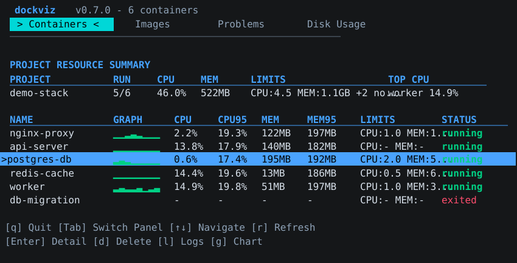
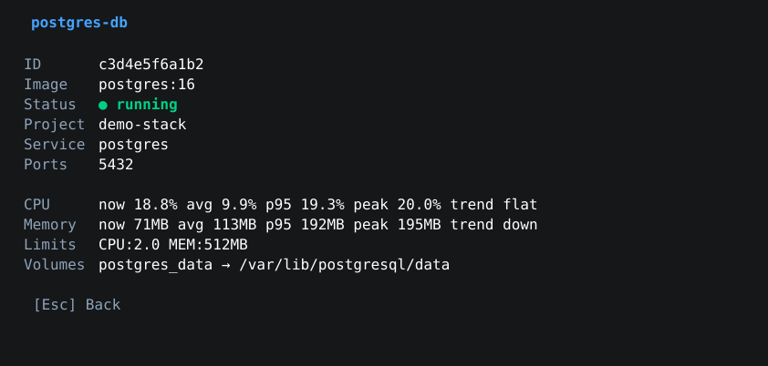
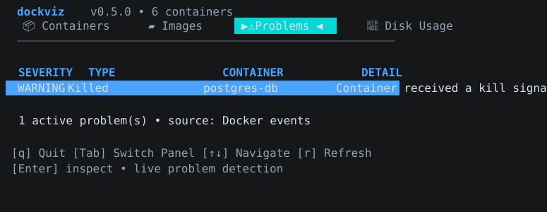
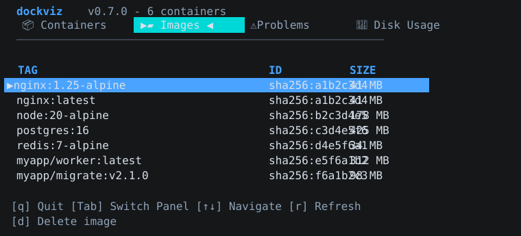
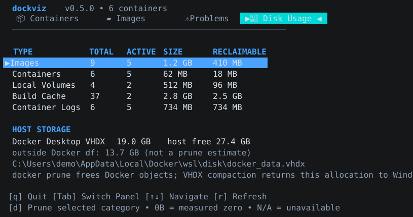
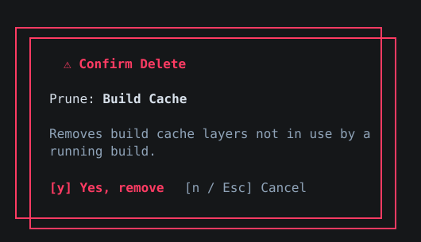
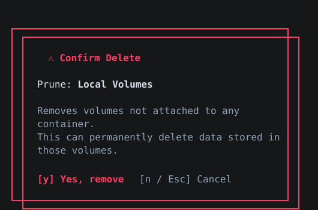

<div align="center">

# dockviz-cli

**Docker 문제와 디스크 정리를 위한 터미널 대시보드**

[](https://go.dev/)
[](LICENSE)
[](https://github.com/0206pdh/dockviz-cli/releases/latest)
[](https://github.com/0206pdh/dockviz-cli/actions/workflows/ci.yml)
[](https://github.com/charmbracelet/bubbletea)

**[English documentation](README.md)**

</div>

---

## 무엇인가

`dockviz`는 두 가지 운영 질문에 답하는 실시간 TUI입니다.

1. 지금 컨테이너에서 의미 있는 장애 신호가 나오고 있는가?
2. Docker 디스크를 무엇이 쓰고 있으며, 무엇을 회수할 수 있는가?

공식 Go SDK로 Docker daemon에 직접 연결합니다. Docker Engine을 대체하거나
범용 Docker 명령어 래퍼가 되려는 도구는 아닙니다.

## 왜 쓰나

Docker CLI는 개별 명령에는 훌륭합니다. `dockviz`는 여러 리소스를 한 화면에서
계속 갱신하며 봐야 할 때 유용합니다.

- 컨테이너 CPU, 메모리, 상태, 포트, 로그, 최근 추이;
- 현재값, p95, peak/trend와 CPU/MEM limit을 담은 리소스 요약;
- service, dependency, network, configured volume을 보여주는 Compose context;
- Docker event와 리소스 history에서 도출한 조치 가능한 문제;
- 이미지, 중지된 컨테이너, 볼륨, build cache, 컨테이너 로그 사용량;
- 확인창을 거치고 실제 회수 용량을 알려주는 정리 동작.

## 대시보드 패널

| 패널 | 목적 |
|---|---|
| Containers | CPU/MEM, compose/project 요약, p95 요약, limit, 상세 정보, 로그, 추이 차트 |
| Images | 로컬 이미지 태그 조회와 안전한 태그/이미지 삭제 |
| Problems | OOM/restart event, high CPU, memory pressure/growth, limit 누락, storage offender, daemon 연결 끊김 |
| Disk Usage | Docker 저장공간 분석과 카테고리별 prune, 잔존 리소스(Leftovers) 목록 |

신호 정의, severity 기준값, 각 prune 동작이 실제로 지우는 대상은
[레퍼런스](docs/reference.ko.md)에 정리되어 있습니다.

Networks, Events 타임라인, `exec`, 컨테이너 start/stop/restart, 이미지 pull
진행률 화면은 현재 제품 범위에서 제외했습니다.

## 스크린샷

| Containers | Container detail |
|---|---|
|  |  |

| Problems | Images |
|---|---|
|  |  |

| Disk Usage |
|---|
|  |

Disk cleanup은 확인창을 거쳐 실행됩니다. Build Cache는 사용 중이 아닌 cache
layer만 정리하고, Local Volumes는 실제 애플리케이션 데이터가 들어 있을 수
있으므로 별도 경고를 표시합니다.

| Build Cache 확인창 | Local Volumes 확인창 |
|---|---|
|  |  |

## 설치

### PyPI

```bash
python -m pip install dockviz            # 설치
python -m pip install --upgrade dockviz  # 업데이트
```

### Debian / Ubuntu APT 저장소

```bash
curl -fsSL https://0206pdh.github.io/dockviz-cli/apt/dockviz-archive-keyring.asc \
  | sudo gpg --dearmor -o /usr/share/keyrings/dockviz-archive-keyring.gpg
echo "deb [signed-by=/usr/share/keyrings/dockviz-archive-keyring.gpg] https://0206pdh.github.io/dockviz-cli/apt stable main" \
  | sudo tee /etc/apt/sources.list.d/dockviz.list > /dev/null
sudo apt update
sudo apt install dockviz
```

업데이트는 `sudo apt update && sudo apt install --only-upgrade dockviz`입니다.

### Linux / macOS release 바이너리

```bash
curl -sL "https://github.com/0206pdh/dockviz-cli/releases/latest/download/dockviz-$(uname -s | tr '[:upper:]' '[:lower:]')-$(uname -m | sed 's/x86_64/amd64/;s/aarch64/arm64/')" \
  -o /usr/local/bin/dockviz
chmod +x /usr/local/bin/dockviz
```

같은 명령을 다시 실행하면 업데이트됩니다. 각 release에는 다운로드 검증용
`SHA256SUMS` 파일이 함께 올라갑니다. `dockviz update` subcommand는 없습니다.

### Windows

[최신 Release](https://github.com/0206pdh/dockviz-cli/releases/latest)에서
`dockviz-windows-amd64.exe` 또는 `dockviz-windows-arm64.exe`를 받으세요.

### 소스 빌드

```bash
git clone https://github.com/0206pdh/dockviz-cli.git
cd dockviz-cli
go build -o dockviz .
```

소스 업데이트는 `git pull` 후 다시 빌드하면 됩니다.

## 빠른 시작

```bash
dockviz                                          # 로컬 daemon. compose.yaml이 있으면 자동으로 읽음
dockviz -f compose.yaml -f compose.override.yaml # Compose 파일 명시
dockviz --demo                                   # 가상 데이터. Docker daemon 불필요
dockviz --host tcp://192.168.1.100:2375          # 원격 daemon (또는 DOCKER_HOST 사용)
dockviz --context colima                         # docker context 지정 (기본: 현재 context)
dockviz --version                                # 빌드 버전 출력
```

일반 실행은 TUI를 띄우기 전에 Docker `Ping()`을 호출합니다. 실제 daemon
연결을 생략하는 모드는 `--demo`뿐입니다.

## Compose context

Compose 파일이 있으면 `dockviz`는
[`compose-go`](https://github.com/compose-spec/compose-go)로 파일을 읽고, 실제
daemon 데이터 위에 service 설정을 겹쳐 보여줍니다. 현재 디렉터리에서
`compose.yaml`, `compose.yml`, `docker-compose.yaml`, `docker-compose.yml`을
자동 탐색하며, `-f/--compose-file`은 여러 번 쓸 수 있습니다.

Compose context는 read-only이며 영향 범위를 설명하는 데 씁니다.

- container detail에서 service dependency, dependent, network, configured volume,
  configured port, Compose 파일 출처를 표시합니다;
- problem detail에서 prune, 삭제, 외부 재시작, limit 변경 전에 같은 service
  blast radius를 보여줍니다;
- 실행 중 컨테이너 label이 기본 정보원이므로 Compose 파일이 없어도 동작합니다.

## 키보드 단축키

| 키 | 동작 |
|---|---|
| `q` / `Ctrl+C` | 종료 |
| `Tab` | Containers, Images, Problems, Disk Usage 전환 |
| `↑` / `k`, `↓` / `j` | 목록 이동 |
| `Enter` | 컨테이너 상세(Containers), 문제 상세(Problems), 잔존 리소스 목록(Disk Usage의 Leftovers 행) |
| `Esc` | 뒤로 가기 / overlay 닫기 |
| `d` | 컨테이너/이미지 삭제, 선택한 디스크 카테고리 prune, 선택한 잔존 리소스 삭제(Leftovers 목록) |
| `l` | 선택한 컨테이너의 실시간 로그 |
| `r` | 새로고침, 필요하면 event stream 재연결 |
| `g` | CPU/MEM 추이 차트 |

## Docker 연결

연결할 daemon은 `docker` CLI와 같은 순서로 정합니다.

1. `--context` 플래그
2. `--host` 플래그
3. `DOCKER_HOST`
4. `DOCKER_CONTEXT`
5. `docker context use`로 정한 현재 context (`~/.docker/config.json`의 `currentContext`)
6. OS 기본 socket

그래서 Docker Desktop(`desktop-linux`), Colima, OrbStack처럼 socket이 기본 위치에
없는 환경도 `docker` 명령이 동작하면 별도 설정 없이 연결됩니다. `--host`와
`--context`는 함께 쓸 수 없고, `ssh://` endpoint context는 아직 지원하지 않습니다.

현재 사용자가 Docker socket 또는 endpoint에 접근할 수 있어야 합니다. 인증 없는
원격 Docker TCP socket은 원격 root 권한과 같으므로 TLS와 네트워크 접근 제어를
사용하세요.

## 검증 근거

핵심 정리/리소스 동작은 mock이 아니라 실제 Docker Desktop WSL2 검증
실행(`dockviz-core-20260730142414`)으로 확인했습니다.

- `--all` 없는 `docker volume prune`은 라벨된 named volume에서 `0B`를 회수했고,
  `docker volume prune --all`은 `8.59GB`를 회수했습니다;
- 813MB multi-tag 이미지에서 태그 하나를 지우면 그 태그만 제거됐습니다;
- 컨테이너 12개의 Go SDK stats 수집이 순차 `19.730s`에서 병렬 `2.058s`로
  줄었습니다(`9.585x`);
- Docker Desktop `docker_data.vhdx`는 별도 host-storage 할당으로 남았습니다.
  dockviz가 이를 Docker reclaimable 용량과 분리해 보여주는 이유입니다.

전체 결과, 재현 명령, 수동 체크리스트는 [docs/validation.ko.md](docs/validation.ko.md)에
있습니다. 부하 시나리오 스크립트는 [`scenarios/`](scenarios/)에 있습니다.

## 문서

전체 목록은 [docs/README.md](docs/README.md)에 있습니다.

| 문서 | 내용 |
|---|---|
| [docs/reference.ko.md](docs/reference.ko.md) | 열과 신호의 의미, severity 기준값, prune이 지우는 대상, 컨테이너·이미지 상태 |
| [TECHNICAL.ko.md](TECHNICAL.ko.md) | 아키텍처, 갱신 흐름, 판정 계산식, 정리 불변식, CI/배포 |
| [docs/validation.ko.md](docs/validation.ko.md) | 실제 daemon 검증 결과, 시나리오 실행법, 수동 체크리스트 |
| [docs/troubleshooting.ko.md](docs/troubleshooting.ko.md) | 개발 중 만난 버그 기록 |
| [TODOS.ko.md](TODOS.ko.md) | 고도화 로드맵과 남은 작업 |

## 개발

```bash
go test ./...
go vet ./...
go build ./...
go run . --demo
```

CI(`.github/workflows/ci.yml`)는 모든 PR과 `main` push에서 gofmt, Linux/Windows/macOS
대상 `go vet`, 세 OS의 `go build`/`go test`, ubuntu의 실제 daemon 통합 테스트
(`DOCKVIZ_INTEGRATION=1 go test -run Integration ./internal/docker/`)를 실행합니다.

```text
main.go
  └─ cmd/root.go                 Cobra 플래그: --demo, --host, --context, -f/--compose-file, --version
      └─ internal/tui/start.go
          ├─ docker.NewClient() / docker.NewDemoClient()   (DockerClient interface)
          ├─ compose.Load()                                (선택적 Compose context)
          └─ Bubble Tea model: Containers · Images · Problems · Disk Usage
```

실제 SDK client와 demo client가 같은 `DockerClient` interface를 구현하므로 daemon
없이도 TUI와 판정 로직을 테스트할 수 있습니다. 단위 테스트는 순수 판정/포맷 로직을
다루고, 실제 daemon 검증은 socket 권한, 파일시스템 공유, 가용 리소스가 환경마다
달라서 `scenarios/`에 별도로 둡니다.

## Release

Release 자동화는 `.github/workflows/release.yml`에 있으며 `v1.2.3` 같은 version
tag를 push할 때만 실행됩니다. 먼저 테스트를 다시 돌린 뒤 Linux/macOS/Windows ×
amd64/arm64 바이너리, Python wheel, `.deb` 패키지를 만들고, `SHA256SUMS`와 함께
GitHub Release를 게시합니다. PyPI와 APT 저장소 게시는 설정에 따라 선택적으로
실행됩니다.

`-ldflags="-X main.version=..."` 없이 만든 로컬 빌드는 `dev`로 표시됩니다.

## License

MIT © 2026 [0206pdh](https://github.com/0206pdh)
