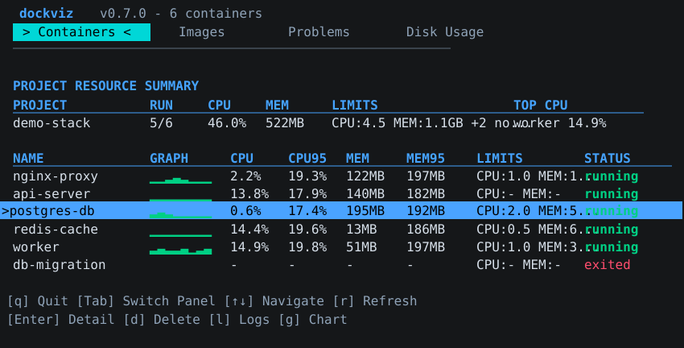
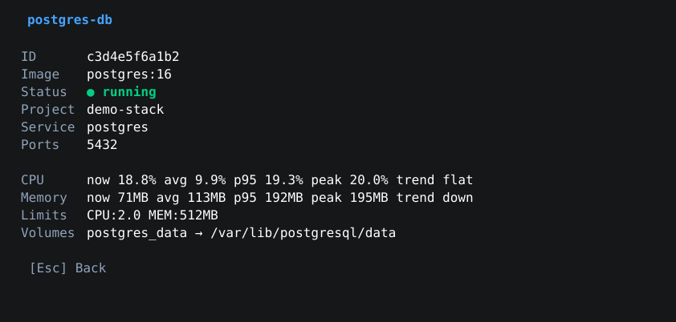
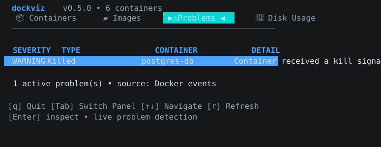
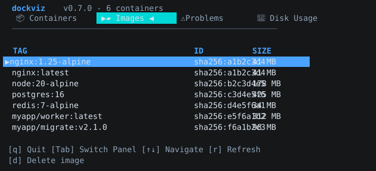
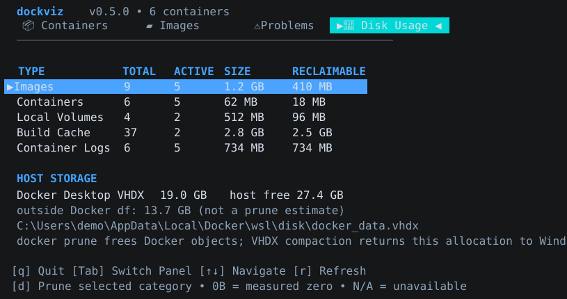
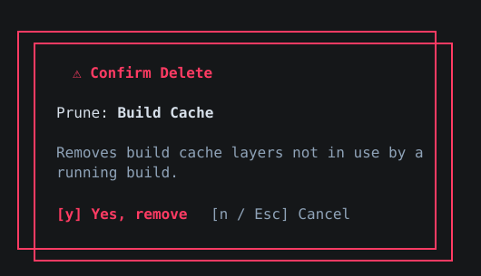
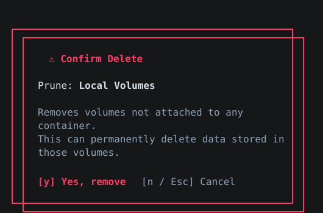

<div align="center">

# dockviz-cli

**A terminal dashboard for Docker problems and storage cleanup.**

[](https://go.dev/)
[](LICENSE)
[](https://github.com/0206pdh/dockviz-cli/releases/latest)
[](https://github.com/0206pdh/dockviz-cli/actions/workflows/ci.yml)
[](https://github.com/charmbracelet/bubbletea)

**[한국어 문서](README.ko.md)**

</div>

---

## What it is

`dockviz` is a live TUI for answering two operational questions:

1. Is a container currently showing a meaningful failure signal?
2. What is using Docker's disk space, and what can be reclaimed?

It connects directly to the Docker daemon through the official Go SDK. It does
not replace Docker Engine or try to be a general-purpose Docker command
wrapper.

## Why use it

The Docker CLI is excellent for individual commands. `dockviz` is useful when
you need a compact, continuously updating view of several resources at once:

- container CPU, memory, status, ports, logs, and recent history;
- resource summaries with current, p95, peak/trend detail, and CPU/MEM limits;
- Compose context for services, dependencies, networks, and configured volumes;
- actionable problems derived from Docker events and resource history;
- image, stopped-container, volume, build-cache, and container-log usage;
- confirmation-gated cleanup actions with the reported reclaimed space.

## Dashboard panels

| Panel | Purpose |
|---|---|
| Containers | Live CPU/MEM, compose/project summary, p95 summaries, limits, detail, logs, and history chart |
| Images | Local image tags and safe tag/image removal |
| Problems | OOM/restart events, high CPU, memory pressure/growth, missing limits, storage offenders, and daemon disconnects |
| Disk Usage | Docker storage breakdown and category-level prune actions |

Signal definitions, severity thresholds, and exactly what each prune action
removes are in the [reference (Korean)](docs/reference.ko.md).

The former Networks, Events timeline, `exec`, container lifecycle controls, and
image pull-progress screens are intentionally outside the current product scope.

## Screenshots

| Containers | Container detail |
|---|---|
|  |  |

| Problems | Images |
|---|---|
|  |  |

| Disk Usage |
|---|
|  |

Disk cleanup actions are confirmation-gated. Build cache cleanup removes only
unused build-cache layers, while volume cleanup warns explicitly because unused
volumes can still contain important application data.

| Build Cache confirmation | Local Volumes confirmation |
|---|---|
|  |  |

## Installation

### PyPI

```bash
python -m pip install dockviz            # install
python -m pip install --upgrade dockviz  # update
```

### Debian / Ubuntu APT repository

```bash
curl -fsSL https://0206pdh.github.io/dockviz-cli/apt/dockviz-archive-keyring.asc \
  | sudo gpg --dearmor -o /usr/share/keyrings/dockviz-archive-keyring.gpg
echo "deb [signed-by=/usr/share/keyrings/dockviz-archive-keyring.gpg] https://0206pdh.github.io/dockviz-cli/apt stable main" \
  | sudo tee /etc/apt/sources.list.d/dockviz.list > /dev/null
sudo apt update
sudo apt install dockviz
```

Update with `sudo apt update && sudo apt install --only-upgrade dockviz`.

### Linux / macOS release binary

```bash
curl -sL "https://github.com/0206pdh/dockviz-cli/releases/latest/download/dockviz-$(uname -s | tr '[:upper:]' '[:lower:]')-$(uname -m | sed 's/x86_64/amd64/;s/aarch64/arm64/')" \
  -o /usr/local/bin/dockviz
chmod +x /usr/local/bin/dockviz
```

Running the same command again updates the binary. Each release also ships a
`SHA256SUMS` file for verifying downloads. There is no `dockviz update`
subcommand.

### Windows

Download `dockviz-windows-amd64.exe` or `dockviz-windows-arm64.exe` from the
[latest release](https://github.com/0206pdh/dockviz-cli/releases/latest).

### Build from source

```bash
git clone https://github.com/0206pdh/dockviz-cli.git
cd dockviz-cli
go build -o dockviz .
```

To update a source checkout, `git pull` and build again.

## Quick start

```bash
dockviz                                          # local daemon; auto-loads compose.yaml if present
dockviz -f compose.yaml -f compose.override.yaml # explicit Compose files
dockviz --demo                                   # simulated data, no Docker daemon required
dockviz --host tcp://192.168.1.100:2375          # remote daemon (or set DOCKER_HOST)
dockviz --context colima                         # pick a docker context (default: current context)
dockviz --version                                # print the build version
```

The default path calls Docker `Ping()` before starting the TUI. `--demo` is
the only mode that avoids a live daemon.

## Compose context

When a Compose file is present, `dockviz` parses it with
[`compose-go`](https://github.com/compose-spec/compose-go) and overlays that
configuration on top of live daemon data. It auto-discovers `compose.yaml`,
`compose.yml`, `docker-compose.yaml`, and `docker-compose.yml` from the current
directory; `-f/--compose-file` can be passed multiple times.

Compose context is read-only and is used to explain impact:

- container detail shows service dependencies, dependents, networks, configured
  volumes, configured ports, and the Compose file source;
- problem detail shows the same service blast radius before you prune, delete,
  restart externally, or change limits;
- live container labels remain the primary runtime source, so dockviz still
  works without a Compose file.

## Keyboard shortcuts

| Key | Action |
|---|---|
| `q` / `Ctrl+C` | Quit |
| `Tab` | Switch between Containers, Images, Problems, and Disk Usage |
| `↑` / `k`, `↓` / `j` | Move up / down |
| `Enter` | Open container detail (Containers) or problem detail (Problems) |
| `Esc` | Go back or close an overlay |
| `d` | Delete selected container/image, or prune the selected disk category |
| `l` | Open live logs for the selected container |
| `r` | Refresh data and reconnect the event stream if needed |
| `g` | Open the CPU/MEM history chart |

## Docker connection

The daemon endpoint is chosen with the same precedence as the `docker` CLI:
`--context`, then `--host`, then `DOCKER_HOST`, then `DOCKER_CONTEXT`, then the
current context from `docker context use`, then the platform default socket.
Docker Desktop (`desktop-linux`), Colima, and OrbStack therefore work without
extra configuration whenever `docker` itself works. `--host` and `--context`
are mutually exclusive, and `ssh://` context endpoints are not supported yet.

The daemon must allow the current user to access its socket or endpoint. A
remote TCP endpoint should be protected with appropriate TLS/network controls;
an unauthenticated Docker TCP socket is equivalent to remote root access.

## Validation evidence

The core cleanup/resource behavior is backed by a real Docker Desktop WSL2
validation run (`dockviz-core-20260730142414`), not only mocks:

- `docker volume prune` without `--all` reclaimed `0B` from labelled named
  volumes, while `docker volume prune --all` reclaimed `8.59GB`;
- deleting one tag from an 813MB multi-tag image removed only that tag;
- Go SDK stats collection across 12 containers went from `19.730s`
  sequential to `2.058s` parallel (`9.585x`);
- Docker Desktop `docker_data.vhdx` stayed a separate host-storage allocation,
  which is why dockviz reports it apart from Docker reclaimable space.

Full results, reproduction commands, and manual checklists:
[docs/validation.ko.md](docs/validation.ko.md) (Korean). The load scenarios
live in [`scenarios/`](scenarios/).

## Documentation

Detailed documentation is maintained in Korean. The full list is in
[docs/README.md](docs/README.md).

| Document | Covers |
|---|---|
| [docs/reference.ko.md](docs/reference.ko.md) | Meaning of every column and signal, severity thresholds, what each prune removes, container/image states |
| [TECHNICAL.ko.md](TECHNICAL.ko.md) | Architecture, refresh flow, classification formulas, cleanup invariants, CI/release |
| [docs/validation.ko.md](docs/validation.ko.md) | Real-daemon validation results, scenario commands, manual checklists |
| [docs/troubleshooting.ko.md](docs/troubleshooting.ko.md) | Development bug log |
| [TODOS.ko.md](TODOS.ko.md) | Roadmap and open work |

## Development

```bash
go test ./...
go vet ./...
go build ./...
go run . --demo
```

CI (`.github/workflows/ci.yml`) runs gofmt, `go vet` for Linux/Windows/macOS,
and `go build`/`go test` on all three OSes for every pull request and push to
`main`.

```text
main.go
  └─ cmd/root.go                 Cobra flags: --demo, --host, --context, -f/--compose-file, --version
      └─ internal/tui/start.go
          ├─ docker.NewClient() / docker.NewDemoClient()   (DockerClient interface)
          ├─ compose.Load()                                (optional Compose context)
          └─ Bubble Tea model: Containers · Images · Problems · Disk Usage
```

The Docker SDK client and the demo client share the `DockerClient` interface,
so the TUI and its classification logic can be tested without a daemon. Unit
tests cover the pure classification/formatting logic; real-daemon validation
is a separate layer in `scenarios/` because socket access, filesystem sharing,
permissions, and available resources depend on the environment.

## Release

Release automation lives in `.github/workflows/release.yml` and runs only when
a version tag such as `v1.2.3` is pushed. The workflow re-runs the test suite
first, then builds Linux/macOS/Windows × amd64/arm64 binaries, Python wheels,
and `.deb` packages, publishes a GitHub Release with `SHA256SUMS`, and
optionally publishes to PyPI and the APT repository.

Local builds without `-ldflags="-X main.version=..."` report `dev`.

## License

MIT © 2026 [0206pdh](https://github.com/0206pdh)
